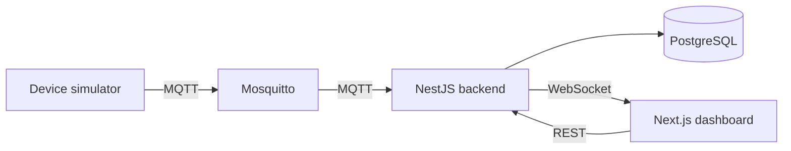

# IoT Monitor

A small IoT monitoring platform. Devices send sensor readings (for example temperature and humidity) over MQTT, a NestJS backend stores them in PostgreSQL, and a Next.js dashboard shows them live.

I am building it step by step as a personal project. The roadmap at the bottom shows what is done and what comes next.

## Architecture

When finished, the pieces fit together like this (the roadmap below shows what is built so far):



- **Devices** are registered through the API with a unique serial, then publish readings to `devices/<serial>/readings`.
- **Backend** subscribes to the broker, validates each reading, saves it and checks it against alert rules.
- **Dashboard** loads history over REST and receives new readings live over WebSocket.

## Tech stack

- **Backend:** NestJS, TypeScript, Prisma, PostgreSQL, Swagger (OpenAPI)
- **Messaging:** MQTT with Mosquitto
- **Frontend:** Next.js, React, Tailwind CSS
- **Infra:** Docker Compose

## Project structure

```
iot-monitor/
├── backend/             NestJS API
│   ├── prisma/          database schema and migrations
│   └── src/             devices, health and prisma modules, plus config and common helpers
├── mosquitto/           MQTT broker config
└── docker-compose.yml   PostgreSQL and Mosquitto for local development
```

## Getting started

You need Node.js 20 or newer and Docker.

1. Start PostgreSQL and Mosquitto:

   ```bash
   docker compose up -d
   ```

   PostgreSQL is exposed on port 5433 instead of 5432, so it does not clash with a PostgreSQL already installed on your machine. Mosquitto listens on 1883.

2. Install, create the database tables and run the backend:

   ```bash
   cd backend
   cp .env.example .env
   npm install
   npm run db:deploy
   npm run start:dev
   ```

3. Check that it is up:

   ```bash
   curl http://localhost:4000/health
   ```

   It should return `{"status":"ok","database":"up",...}`. The API docs (Swagger UI) are at http://localhost:4000/docs.

When you change `backend/prisma/schema.prisma`, run `npm run db:migrate` in `backend/` to create and apply a new migration. `npm run db:studio` opens Prisma Studio if you want to browse the data.

## API

| Method | Path           | What it does                                           |
| ------ | -------------- | ------------------------------------------------------ |
| GET    | `/health`      | API and database status (503 if the database is down) |
| POST   | `/devices`     | Register a device                                      |
| GET    | `/devices`     | List all devices                                       |
| GET    | `/devices/:id` | Get one device                                         |
| PATCH  | `/devices/:id` | Change a device's name or location                     |
| DELETE | `/devices/:id` | Delete a device                                        |

Register a device:

```bash
curl -X POST http://localhost:4000/devices \
  -H "Content-Type: application/json" \
  -d '{"serial": "sensor-01", "name": "Server room sensor", "location": "Office"}'
```

The serial goes into the device's MQTT topic, so it must be 2 to 63 lowercase letters, digits or dashes, starting with a letter or digit. It cannot be changed after registration. Requests with unknown fields are rejected with a 400 error.

## Roadmap

- [x] Project setup: Docker Compose with PostgreSQL and Mosquitto, NestJS backend with a health check
- [x] Devices API with Prisma, request validation and Swagger docs
- [ ] Save readings received over MQTT
- [ ] Device simulator
- [ ] Alerts for out-of-range readings and offline devices
- [ ] Live updates over WebSocket
- [ ] Next.js dashboard
- [ ] Tests and CI with GitHub Actions
