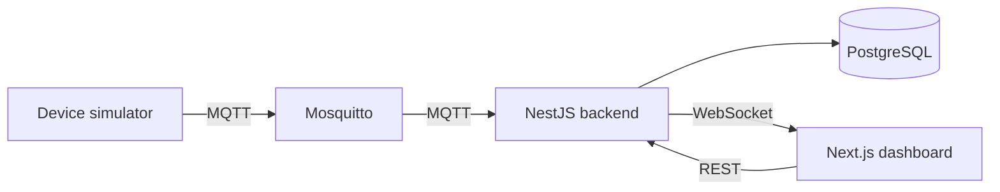
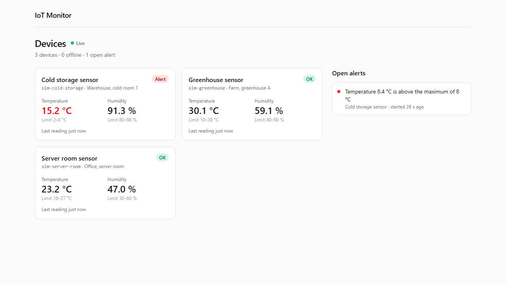

# IoT Monitor

[](https://github.com/Darshan0502/iot-monitor/actions/workflows/ci.yml)

A small IoT monitoring platform. Devices send sensor readings (for example temperature and humidity) over MQTT, a NestJS backend stores them in PostgreSQL, and a Next.js dashboard shows them live.

I built it step by step as a personal project. The roadmap at the bottom shows the steps and some ideas for later.

## Architecture



- **Devices** are registered through the API with a unique serial, then publish readings to `devices/<serial>/readings`.
- **Backend** subscribes to the broker, validates each reading, saves it and checks it against alert rules.
- **Dashboard** loads history over REST and receives new readings live over WebSocket.

## Tech stack

- **Backend:** NestJS, TypeScript, Prisma, PostgreSQL, Socket.IO, Swagger (OpenAPI)
- **Messaging:** MQTT with Mosquitto
- **Frontend:** Next.js (App Router), React, Tailwind CSS, Socket.IO client
- **Testing:** Jest (unit and end-to-end tests, with supertest), GitHub Actions
- **Infra:** Docker Compose

## Project structure

```
iot-monitor/
├── backend/             NestJS API
│   ├── prisma/          database schema and migrations
│   ├── src/             devices, readings, alerts, live, mqtt, health and prisma modules, plus config and common helpers
│   └── test/            end-to-end tests
├── dashboard/           Next.js dashboard
│   └── src/             pages (app/), components and the API and live-update helpers (lib/)
├── simulator/           fake sensors that publish readings, for running the project without hardware
├── mosquitto/           MQTT broker config
├── .github/workflows/   CI on GitHub Actions
└── docker-compose.yml   PostgreSQL and Mosquitto for local development
```

## Getting started

You need Node.js 20 or newer and Docker.

1. Start PostgreSQL and Mosquitto:

   ```bash
   docker compose up -d
   ```

   PostgreSQL is exposed on port 5433 instead of 5432, so it does not clash with a PostgreSQL already installed on your machine. Mosquitto listens on 1883.

2. Install, create the database tables and run the backend:

   ```bash
   cd backend
   cp .env.example .env
   npm install
   npm run db:deploy
   npm run start:dev
   ```

3. Check that it is up:

   ```bash
   curl http://localhost:4000/health
   ```

   It should return `{"status":"ok","database":"up","mqtt":"connected",...}`. The API docs (Swagger UI) are at http://localhost:4000/docs.

4. Start the device simulator in a second terminal:

   ```bash
   cd simulator
   npm install
   npm start
   ```

   It registers three sensors (a cold storage, a server room and a greenhouse), gives each one alert limits that fit its place (for example 2-8 °C for the cold storage) and sends realistic readings every 5 seconds, with a slow daily rise and fall plus small random changes. Settings come from environment variables: `API_URL` (default `http://localhost:4000`), `MQTT_URL` (default `mqtt://localhost:1883`), `INTERVAL_SECONDS` (default `5`) and `FAULT` (see [Alerts](#alerts)).

5. Start the dashboard in a third terminal and open http://localhost:3000:

   ```bash
   cd dashboard
   npm install
   npm run dev
   ```

   It expects the backend on `http://localhost:4000`. If it runs somewhere else, copy `.env.example` to `.env.local` and change `NEXT_PUBLIC_API_URL`.

When you change `backend/prisma/schema.prisma`, run `npm run db:migrate` in `backend/` to create and apply a new migration. `npm run db:studio` opens Prisma Studio if you want to browse the data.

## API

| Method | Path                    | What it does                                                    |
| ------ | ----------------------- | --------------------------------------------------------------- |
| GET    | `/health`               | API, database and MQTT status (503 if the database is down)    |
| POST   | `/devices`              | Register a device                                               |
| GET    | `/devices`              | List all devices                                                |
| GET    | `/devices/:id`          | Get one device                                                  |
| PATCH  | `/devices/:id`          | Change a device's name or location                              |
| PUT    | `/devices/:id/limits`   | Set a device's alert limits                                     |
| DELETE | `/devices/:id`          | Delete a device with its readings and alerts                    |
| GET    | `/devices/:id/readings` | A device's readings, newest first (`limit`, `from`, `to`)       |
| GET    | `/readings/latest`      | The newest reading of every device that has sent one            |
| GET    | `/alerts`               | Alerts, newest first (`status`, `deviceId`, `limit`)            |

Register a device:

```bash
curl -X POST http://localhost:4000/devices \
  -H "Content-Type: application/json" \
  -d '{"serial": "sensor-01", "name": "Server room sensor", "location": "Office"}'
```

The serial goes into the device's MQTT topic, so it must be 2 to 63 lowercase letters, digits or dashes, starting with a letter or digit. It cannot be changed after registration. Requests with unknown fields are rejected with a 400 error.

## Sending readings

A registered device publishes JSON to `devices/<serial>/readings`. You can try it from the Mosquitto container:

```bash
docker compose exec mosquitto mosquitto_pub -t devices/sensor-01/readings \
  -m '{"temperature": 23.5, "humidity": 41}'
```

Then `GET /devices/<id>/readings` returns it, and the device's `lastSeenAt` is updated.

| Field         | Rules                                                                     |
| ------------- | ------------------------------------------------------------------------- |
| `temperature` | Number from -40 to 125 (°C)                                               |
| `humidity`    | Number from 0 to 100 (%)                                                  |
| `timestamp`   | Optional ISO 8601 time with a time zone; the arrival time is used if missing |

At least one of `temperature` and `humidity` is required. The backend ignores and logs anything else instead of saving it: invalid JSON, values out of range, unknown fields, timestamps more than 5 minutes in the future, payloads over 1 KB, and serials that are not registered. If the broker goes down, the REST API keeps working and the backend reconnects on its own.

## Alerts

Give a device alert limits:

```bash
curl -X PUT http://localhost:4000/devices/<id>/limits \
  -H "Content-Type: application/json" \
  -d '{"temperatureMin": 2, "temperatureMax": 8, "humidityMin": 80, "humidityMax": 98}'
```

PUT replaces all four limits at once. A missing or `null` limit means no limit on that side, and a minimum must be lower than its maximum.

| Alert type                              | Opens when                                                                             |
| --------------------------------------- | -------------------------------------------------------------------------------------- |
| `TEMPERATURE_HIGH`, `TEMPERATURE_LOW`   | A reading is above the maximum or below the minimum temperature                        |
| `HUMIDITY_HIGH`, `HUMIDITY_LOW`         | The same for humidity                                                                  |
| `OFFLINE`                               | A device that has sent readings before sends none for `OFFLINE_AFTER_SECONDS` (default 60) |

An alert stays open while the problem lasts, so a device that keeps sending high readings has one alert, not one per reading. The first reading back inside the limits resolves it, and any reading at all resolves an `OFFLINE` alert. Opened and resolved alerts are also written to the backend log.

The backend saves readings in four lanes at a time, and a device always uses the same lane. So a device's readings are saved one after the other, in the order they arrived, and a burst of readings cannot use up the database connections. Saving a reading also locks its device's row until the reading and its alerts are saved, so the offline check, or a second copy of the backend, waits for it. Two readings of the same device can never both open the same alert.

To see alerts without real hardware, start the simulator with a fault:

```bash
FAULT=sim-cold-storage:heat npm start     # the cold room loses its cooling and warms up
FAULT=sim-server-room:offline npm start   # the server room sensor goes quiet after one reading
```

## Live updates

The backend also accepts [Socket.IO](https://socket.io) connections on the API port and pushes every change as it happens, so a dashboard never has to poll.

| Event     | Sent when                       | Data                                                                          |
| --------- | ------------------------------- | ----------------------------------------------------------------------------- |
| `reading` | A reading has been saved        | `deviceId`, `serial`, `temperature`, `humidity`, `recordedAt`                 |
| `alert`   | An alert opens or is resolved   | The alert as `GET /alerts` returns it; `resolvedAt` is `null` while it is open |

A new client hears about every device. To watch a single device, for example on that device's page, send `follow` with its id; `unfollow` goes back to every device. Both answer through the acknowledgement callback.

```js
import { io } from 'socket.io-client';

const socket = io('http://localhost:4000');
socket.on('reading', (reading) => console.log(reading.serial, reading.temperature, reading.humidity));
socket.on('alert', (alert) => console.log(alert.resolvedAt ? 'resolved:' : 'opened:', alert.message));

await socket.emitWithAck('follow', deviceId); // { following: '<deviceId>' }, or { error } if it is not a UUID
await socket.emitWithAck('unfollow');         // { following: 'all' }
```

Events are sent only after the database transaction has committed, so a client never sees a reading or an alert that was rolled back. Browsers may connect, and call the REST API, from the origins in `CORS_ORIGINS` (default `http://localhost:3000`, where the dashboard runs).

## Dashboard



- **Overview (`/`):** a card per device with its latest temperature and humidity, its alert limits, when it last sent a reading, and a status: OK, Alert, Offline or No data. A value with an open alert is shown in red, and the last values of an offline device are greyed out. The open alerts are listed next to the cards.
- **Device page (`/devices/:id`):** the current values, a chart for each value with the alert limits as dashed lines (the last 180 readings, about 15 minutes from the simulator), and the device's alert history. The charts are plain SVG, so there is no chart library.

How it stays up to date:

- The page is rendered on the server with data from the REST API, so it shows real values as soon as it opens.
- In the browser it opens a Socket.IO connection and applies every `reading` and `alert` event to what is on screen. The device page sends `follow`, so it only hears about its own device.
- Events sent while the socket is disconnected are lost, so the page loads its data again over REST every time the socket connects. Events that arrive during that load are kept and applied again on top of the fresh data, and applying an event twice changes nothing. After a reconnect the device page sends `follow` again, because the backend sees a new connection.
- The backend decides when a device is out of range or offline. The dashboard does not repeat those rules; it only shows the open alerts.

`NEXT_PUBLIC_API_URL` is built into the browser code, so change it before `npm run build`, not after.

## Tests

```bash
cd backend
npm test           # unit tests, no database needed
npm run test:e2e   # end-to-end tests; start PostgreSQL and Mosquitto first (docker compose up -d)

cd ../dashboard
npm test
```

- **Backend unit tests** check one class at a time, with the database and the socket replaced by fakes through Nest's testing module: reading validation and saving, the order of saves in a lane, publishing only after the commit, opening and resolving alerts, the request validation rules and the environment checks.
- **End-to-end tests** start the whole backend on a free port with a real PostgreSQL and Mosquitto, and go through it from the outside: the REST API, readings sent over MQTT, alerts, the offline check and the Socket.IO events. They use their own database schema (`e2e`), so they never touch your development data.
- **Dashboard tests** check how each live event changes the data a page shows, including events that arrive out of order or twice.

[GitHub Actions](.github/workflows/ci.yml) runs all of them on every push and pull request: the backend is built and tested against PostgreSQL and Mosquitto started with Docker Compose, the dashboard is type-checked, tested and built, and the simulator is type-checked.

## Roadmap

- [x] Project setup: Docker Compose with PostgreSQL and Mosquitto, NestJS backend with a health check
- [x] Devices API with Prisma, request validation and Swagger docs
- [x] Save readings received over MQTT
- [x] Device simulator
- [x] Alerts for out-of-range readings and offline devices
- [x] Live updates over WebSocket
- [x] Next.js dashboard
- [x] Tests and CI with GitHub Actions

Ideas for later:

- Sign-in for the API and the dashboard
- Ignore duplicate readings (MQTT QoS 1 can deliver a message twice)
- Delete or summarize old readings, so the table does not grow forever
- Docker images for the backend and the dashboard
