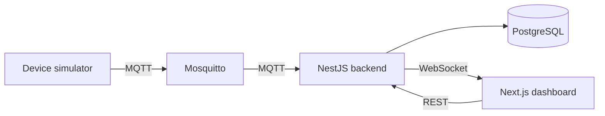

# IoT Monitor

A small IoT monitoring platform. Devices send sensor readings (for example temperature and humidity) over MQTT, a NestJS backend stores them in PostgreSQL, and a Next.js dashboard shows them live.

I am building it step by step as a personal project. The roadmap at the bottom shows what is done and what comes next.

## Architecture



- **Devices** publish readings to `devices/<deviceId>/readings`.
- **Backend** subscribes to the broker, validates each reading, saves it and checks it against alert rules.
- **Dashboard** loads history over REST and receives new readings live over WebSocket.

## Tech stack

- **Backend:** NestJS, TypeScript, Prisma, PostgreSQL
- **Messaging:** MQTT with Mosquitto
- **Frontend:** Next.js, React, Tailwind CSS
- **Infra:** Docker Compose

## Project structure

```
iot-monitor/
├── backend/             NestJS API
├── mosquitto/           MQTT broker config
└── docker-compose.yml   PostgreSQL and Mosquitto for local development
```

## Getting started

You need Node.js 20 or newer and Docker.

1. Start PostgreSQL and Mosquitto:

   ```bash
   docker compose up -d
   ```

   PostgreSQL is exposed on port 5433 instead of 5432, so it does not clash with a PostgreSQL already installed on your machine. Mosquitto listens on 1883.

2. Run the backend:

   ```bash
   cd backend
   cp .env.example .env
   npm install
   npm run start:dev
   ```

3. Check that it is up:

   ```bash
   curl http://localhost:4000/health
   ```

## Roadmap

- [x] Project setup: Docker Compose with PostgreSQL and Mosquitto, NestJS backend with a health check
- [ ] Devices API with Prisma
- [ ] Save readings received over MQTT
- [ ] Device simulator
- [ ] Alerts for out-of-range readings and offline devices
- [ ] Live updates over WebSocket
- [ ] Next.js dashboard
- [ ] Tests and CI with GitHub Actions
